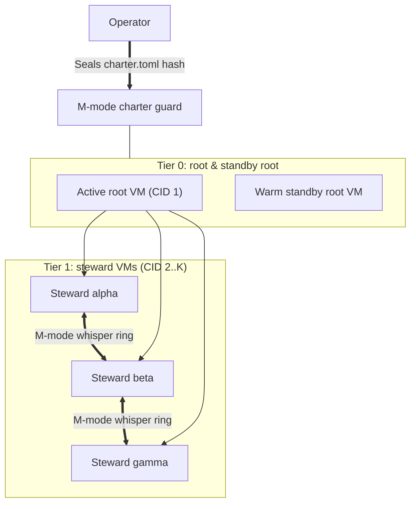

# Hypervisor architecture and design decisions

Diosix is a bare-metal type-1 hypervisor written in freestanding Zig for
multi-core 64-bit RISC-V systems. Instead of placing hardware drivers,
filesystems, or network protocol stacks inside machine mode (M-mode), Diosix
pairs a small M-mode hypervisor with a hierarchical tree of virtual machines
(VMs) headed by a privileged Linux root VM.

This document explains how the hypervisor works internally and why key design
choices were made. For a file-by-file map of every module, see the
[Feature support matrix](support-matrix.md); for exact hypercall numbers and
data structures, see [Shared interface and ABI](interface.md).

---

## Core design philosophy and rationale

### Self-organizing, symmetric VM tree
Placing complex device drivers, storage parsers, and network stacks inside the
highest CPU privilege ring enlarges the trusted computing base (TCB)—the
privileged code where a single bug can compromise the whole machine.

Diosix restricts M-mode to four responsibilities:

* Partitioning physical RAM with a reference-counted buddy allocator and
  second-stage Sv39x4 page tables or physical memory protection (PMP).
* Scheduling virtual CPU (vCPU) cores across up to 4,096 physical harts using
  per-core and global red-black virtual-runtime trees that enforce proportional
  physical CPU share ceilings while remaining work-conserving when idle cycles
  exist.
* Trapping and emulating virtual peripherals for child guests, including
  VirtIO 1.1 block, network, socket, 2D display, and input devices alongside
  the platform-level interrupt controller (PLIC), core-local interruptor
  (CLINT), Goldfish real-time clock (RTC), and 16550A universal asynchronous
  receiver-transmitter (UART).
* Dispatching supervisor binary interface (SBI) hypercalls, switching layer-2
  (L2) Ethernet and virtual socket (vsock) frames, and enforcing charter
  governance rules.

At boot, M-mode unpacks and starts the initial VM (the root VM) with hardware
passthrough and inheritable trust enabled, acting as its hypervisor parent. To
the hypervisor, every VM is structurally identical regardless of tree depth:
each inspects its device tree for available hardware and its manifest for its
role, and receives an explicit quota to use or share downward. To leave most
host RAM free for descendant subtrees on large systems, M-mode gives this first
VM one-quarter (25%) of host RAM—clamped between 128 MiB and 512 MiB—and 1 to
4 virtual CPUs, holding the remaining DRAM in the shared buddy pool.

### Hierarchical VM tree and relative CIDs
Rather than tracking guests in a flat list or special-casing a privileged
supervisor, Diosix organizes VMs into a symmetric, self-organizing tree where
every VM sees CID 1 for itself and addresses only its immediate neighborhood:
CID 0 reaches its parent, CID 1 addresses itself, and CIDs 2 and above address
direct children it created. Child subtrees stay strictly opaque to parents—info
queries on a direct child mask nested child counts to zero—while any VM can
partition its quota, run management tools, and spawn subtrees recursively.

This structure gives the hypervisor three properties:

* Guest VMs never see global hypervisor IDs, so a child VM has no way to
  address or enumerate siblings, ancestors, or unrelated subtrees.
* Each parent VM carves child allocations out of its own RAM and physical CPU
  quota pool, keeping global resource policy out of M-mode.
* When any VM exits or crashes, M-mode recursively terminates all of its
  descendants and returns their physical pages to the parent's pool, leaving no
  orphaned guests.

### Single hypervisor binary and guest shim
External bootloaders add large pre-boot codebases and board-specific
configuration files. Diosix avoids external bootloaders with two in-tree
components:

* A position-independent M-mode hypervisor binary embeds the root VM ELF image
  directly and discovers CPUs, memory banks, timers, and UARTs at runtime from
  the host flattened device tree (FDT).
* A freestanding S-mode guest bootloader shim runs inside untrusted child VMs
  to boot 64-bit RISC-V kernels from ISO9660 images, raw or ext4 disk images,
  and self-contained EFI binaries without exposing parsing logic in M-mode.

---

## Execution engines and memory virtualization

Every virtual core is represented by a unified vCPU state machine that lets the
red-black tree scheduler switch between native hardware-virtualized guests and
emulated guests through one dispatch path:

| Aspect | Native H-extension guest (64-bit) | Native PMP fallback (64-bit) | Recompiled guest (32-bit) |
| :--- | :--- | :--- | :--- |
| Execution mode | Runs directly in virtual supervisor and virtual user modes. | Runs directly in host S-mode and user mode (U-mode). | Just-in-time (JIT) 64-bit RISC-V blocks with a fallback interpreter. |
| Memory isolation | Second-stage Sv39x4 demand paging. | M-mode PMP bounds shielding hypervisor memory. | 4,096-entry software translation lookaside buffer (TLB) walking Sv32 page tables within guest RAM. |
| Memory-mapped input/output (MMIO) | Stage-2 guest page-fault trap and emulate in M-mode. | Direct physical MMIO outside hypervisor memory. | Routed by software TLB load and store helpers to the virtual bus. |
| Interrupt delivery | Hardware virtual external, timer, and software interrupt injection. | Delegated S-mode interrupts. | Checked at block boundaries via virtual CLINT and PLIC state. |

### Stage-2 MMIO trap-and-emulate
Mainline Linux and BSD kernels expect standard RISC-V virtual machine
peripherals at fixed guest physical address (GPA) windows. For stage-2 VMs
without hardware passthrough, those GPA windows remain unmapped in Sv39x4
page tables. When a guest S-mode driver executes a 32-bit or compressed 16-bit
integer load or store to a virtual peripheral address, M-mode handles the fault
in four steps:

1. The processor traps to M-mode on a guest load or store page fault.
2. M-mode verifies that the fault originated from a stage-2 guest executing in
   S-mode, rejecting U-mode faults immediately.
3. Because the RISC-V guest-physical fault address register shifts out the low
   two bits of the faulting GPA, M-mode restores the sub-word byte offset from
   the guest virtual fault register so byte-sized accesses to UART and VirtIO
   configuration registers remain intact.
4. The instruction decoder decodes the load or store, dispatches it to the
   guest's virtual device bus, advances the program counter by 2 or 4 bytes,
   and synchronizes pending PLIC device interrupts into the guest's virtual
   external interrupt line.

### Dynamic binary recompiler and interpreter
To run single-core 32-bit RISC-V guests on 64-bit hosts that lack hardware
32-bit execution mode, Diosix pairs a freestanding dynamic recompiler with a
software interpreter:

* The translator compiles blocks of up to 64 32-bit instructions into native
  64-bit instructions inside an 8 MiB per-slot code cache, mapping guest
  registers 1:1 onto host general-purpose registers using 32-bit sign-extending
  instructions and instruction-fence flushes.
* Guest virtual addresses (GVAs) resolve through a 4,096-entry direct-mapped
  software TLB backed by a two-level Sv32 page-table walker restricted to the
  guest's physical RAM pages.
* Privileged and control and status register (CSR) instructions, cross-page or
  MMIO memory accesses, and debugger single-steps exit the translated block
  cleanly into the software interpreter.

### Freestanding S-mode guest bootloader shim
When launching an ISO9660 installer, seeded disk image, or EFI stub (up to
256 MiB) in a 64-bit child VM, the management tool stages the media into the
upper half of child RAM alongside a small descriptor header and boots the
freestanding S-mode shim:

* For ISO9660, FAT32, and ext volumes, the shim locates an ELF or flat RISC-V
  kernel and optional initial RAM disk, patches the ramdisk bounds and command
  line into the child device tree blob (DTB), and jumps to the guest kernel in
  S-mode.
* For self-contained portable executable (PE32+) EFI binaries, the shim maps
  each section and passes a minimal EFI system table header (full UEFI boot
  services callbacks are not yet populated).

---

## Virtual switch, VirtIO, and console rings

### Dual-path virtual networking
The M-mode virtual switch forwards Ethernet frames across two guest interfaces
over a shared routing path:

* Guests that include the Diosix Linux kernel driver send and receive frames
  directly through SBI hypercalls.
* Unmodified 64-bit Linux and BSD guests use their built-in VirtIO 1.1 network
  driver backed by M-mode MMIO emulation.

M-mode stamps outgoing child frames with the sender's assigned media access
control (MAC) address to prevent spoofing, drops all traffic to and from
air-gapped VMs, and blocks direct sibling-to-sibling frames unless one sibling
is configured as the other's upstream router VM. Any parent VM automatically
serves as a local gateway over `diosix0` (`10.0.3.1/24` at depth 0, stepping to
`10.0.<3+depth>.1/24` in nested subtrees), routing packets across its uplink.

### VirtIO storage, socket, and desktop devices
* The VirtIO block device exposes a RAM-backed virtual disk attached to the
  guest's staged disk image (read-write in guest RAM) or ISO image (read-only).
* The VirtIO socket device routes host-to-guest and parent-to-child stream
  packets with hypervisor-verified source CID headers.
* The VirtIO 2D GPU controller tracks guest scatter-gather backing pages and
  maintains a per-resource dirty-rectangle damage ring without duplicating
  framebuffers in M-mode. Parents on H-extension hardware can map a child's
  active scanout read-only into a two-slot, 16 MiB-per-slot Sv39x4 aperture at
  GPA `0x2_1000_0000` (cleanly unmapped before guest RAM reclamation) and read
  only damaged regions plus the 64x64 cursor overlay, or stream chunks into
  pinned pages when needed.
* The VirtIO input device exposes keyboard, mouse button, scroll wheel, and
  absolute tablet capabilities and delivers batched host input events into the
  guest's event queue via direct memory access (DMA).

### Unified M-mode console rings
Each guest owns an interrupt-safe 8 KiB transmit ring and 512-byte receive ring
in M-mode. Guest output from both the SBI debug console and the emulated
16550A UART feeds the transmit ring, while parent console input writes into the
receive ring and wakes idle vCPUs waiting for interrupts.

---

## Charter guard and standby root failover

To protect critical deployments against root VM crashes or misbehavior, M-mode
enforces charter governance rules directly below the root VM:

* Sealing a charter records the SHA-256 digest of the charter manifest and the
  required steward quorum threshold in M-mode.
* M-mode blocks parent console, graphical scanout, and virtual input access to
  steward VMs, and once sealed, blocks foreign memory mapping and denies
  termination, resets, or quota reductions unless a quorum of stewards casts
  ratification votes in M-mode (the top-level VM cannot vote).
* Steward VMs exchange consensus messages through dedicated M-mode whisper ring
  buffers that do not traverse the parent VM's network switch.
* When a warm standby replica is running and either the initial top-level VM
  crashes or a quorum of stewards ratifies failover, M-mode revokes hardware
  trust from the exiting VM, promotes the standby replica as the new top-level
  VM, and reparents surviving child VMs in place.

---

## Memory address space terminology

Diosix distinguishes three address spaces across code and documentation:

| Address space | Meaning |
| :--- | :--- |
| Host physical address (HPA) | A physical DRAM or device MMIO address on the host hardware. |
| Guest physical address (GPA) | A physical address from a guest VM's perspective, translated to HPAs by second-stage Sv39x4 page tables or bounded by PMP rules. |
| Guest virtual address (GVA) | A virtual address translated by a guest OS kernel's first-stage page tables. |
