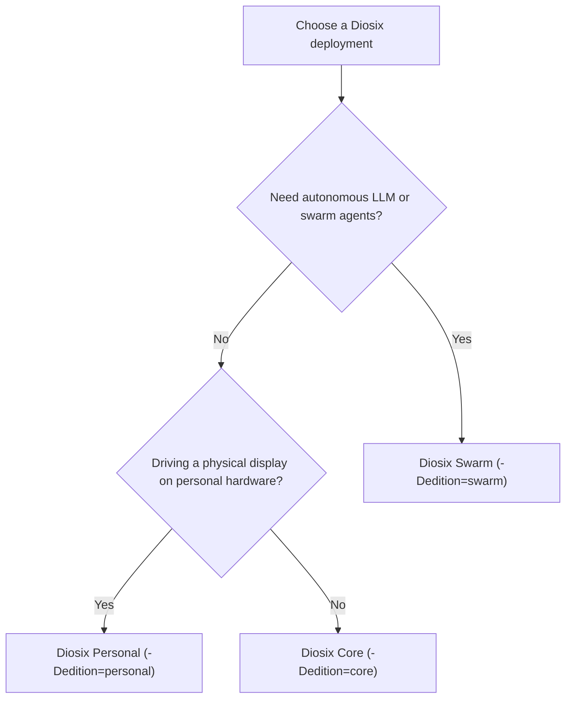

# Diosix editions

Diosix builds into three focused editions from a shared bare-metal machine-mode
(M-mode) hypervisor core and a shared `diosix-node.elf` base filesystem. Each
edition layers only the init scripts, configuration defaults, and runtime
services required for its deployment model.

---

## SSH-first interaction model

Mainline Diosix treats SSH and the serial console as the primary administrative
and operator interfaces:

* Every host and child virtual machine (VM) boots headless with key-only SSH
  and serial console access, avoiding heavyweight graphical display stacks in
  the root VM.
* Workloads that need a graphical user interface serve web applications or
  remote network protocols over their isolated virtual network rather than
  relying on hypervisor framebuffer rendering.
* Removing VirtIO-GPU and VirtIO-Input emulation from mainline M-mode shrinks
  the trusted computing base (TCB) of both the hypervisor and the root VM.
* The legacy native desktop compositor (`diosix-gui`) and M-mode VirtIO-GPU
  scanout bridge remain preserved on the repository's `gui` branch (`git
  checkout gui`).

---

## Comparing Diosix editions

| Edition | Build flag | Included overlays | Startup services | Primary use case |
| :--- | :--- | :--- | :--- | :--- |
| **Diosix Core** | `-Dedition=core` | `tools/overlay-common/` | Key-only SSH, `diosix0` switch, `dsx pkg serve` | Single-host sandboxes, embedded appliances, and non-agent infrastructure VMs. |
| **Diosix Swarm** | `-Dedition=swarm` (default) | `tools/overlay-common/` + `tools/overlay-swarm/` | Core services plus `dsx agent proxy`, `dsx board serve`, `dsx swarm`, and `diosix-agent-start` | Headless multi-VM and multi-host self-orchestrating autonomous agent fleets. |
| **Diosix Personal** | `-Dedition=personal` | `tools/overlay-common/` + `tools/overlay-personal/` | Core services plus `/etc/diosix/personal.toml` desktop template | Personal workstation or tablet hardware (such as PineTab-V) running a small management VM and a dedicated desktop guest VM. |



---

## Building and selecting an edition

Pass `-Dedition=<core|swarm|personal>` when building from source with
`./scripts/build.sh` or packaging standalone releases:

```bash
# Build headless Diosix Core (embedded / single-host non-swarm)
./scripts/build.sh -Dedition=core

# Build Diosix Swarm (default autonomous fleet edition)
./scripts/build.sh -Dedition=swarm

# Build Diosix Personal (management VM + desktop guest profile)
./scripts/build.sh -Dedition=personal
```

At boot, `S50diosix` reads `/etc/diosix/edition` (adopting persistent overrides
from `/var/lib/diosix/state/edition` written by `dsx host install --edition`)
and records `DIOSIX_EDITION` in `/run/diosix/node-env`. Only `swarm` (or hosts
booted with explicit `diosix.swarm=1` or `diosix.swarm_ip=` kernel parameters)
starts the message board, large language model (LLM) proxy, and autonomous agent
daemons. On `personal` hosts, `S50diosix` links `/var/lib/diosix/etc/`
when persistent storage is mounted (adopting `personal.toml`) and launches
`dsx personal start` at boot whenever `auto_start = true` is configured.

Packaging produces an edition-tagged tarball alongside the standalone
`libdiosix` C and Zig software development kit (SDK):

```bash
./scripts/package_release.sh riscv64 swarm
# Produces:
#   zig-out/release/diosix-26.1-swarm-riscv64.tar.xz
#   zig-out/release/libdiosix-26.1-riscv64.tar.xz
```

---

## Direct hardware access and desktop workloads

Diosix Personal keeps the top-level management VM small and SSH-accessible so
an administrator can stop, reboot, or swap a full-screen desktop guest VM
without rebooting the machine.

Release bundles do not bake a large distribution desktop disk image into the
firmware payload. Operators supply or download their own desktop image into
`/var/lib/diosix/images/`, configure profiles with `dsx personal configure`,
and start, stop, or switch desktop guests with `dsx personal start`,
`dsx personal stop`, and `dsx personal switch`.

All four Diosix runtime workflows support the edition model:

1. Immediate QEMU evaluation: Run `./scripts/build.sh run-personal` (or pass
   `-Dedition=personal`) for a persistent RAM-plus-disk development session.
2. Removable live media: Flash `./scripts/make_live_image.sh` output to a
   removable drive; live boot keeps `/etc/diosix/edition` and runs entirely
   in RAM so target disks remain unmounted.
3. Target installation: Run `dsx host install --edition personal` (with
   optional `--personal-image`, `--dma-trusted`, and `--auto-start`) to persist
   `/var/lib/diosix/state/edition` and `/var/lib/diosix/etc/personal.toml`.
4. Persistent post-install boot: On reboot, `S50diosix` adopts the stored
   edition override and `/var/lib/diosix/etc/personal.toml`, auto-starting the
   default desktop profile when `auto_start = true`.

Direct device passthrough for graphics, USB, or input peripherals changes the
hardware isolation boundary on processors lacking an input-output memory
management unit (IOMMU). Before delegating hardware controllers to a desktop
guest VM using direct memory access (DMA, enabled by `dma_trusted = true` in
`/etc/diosix/personal.toml`), review the
[direct device passthrough and DMA security][pt-sec] threat model.

[pt-sec]: security.md#direct-device-passthrough-and-dma-security
