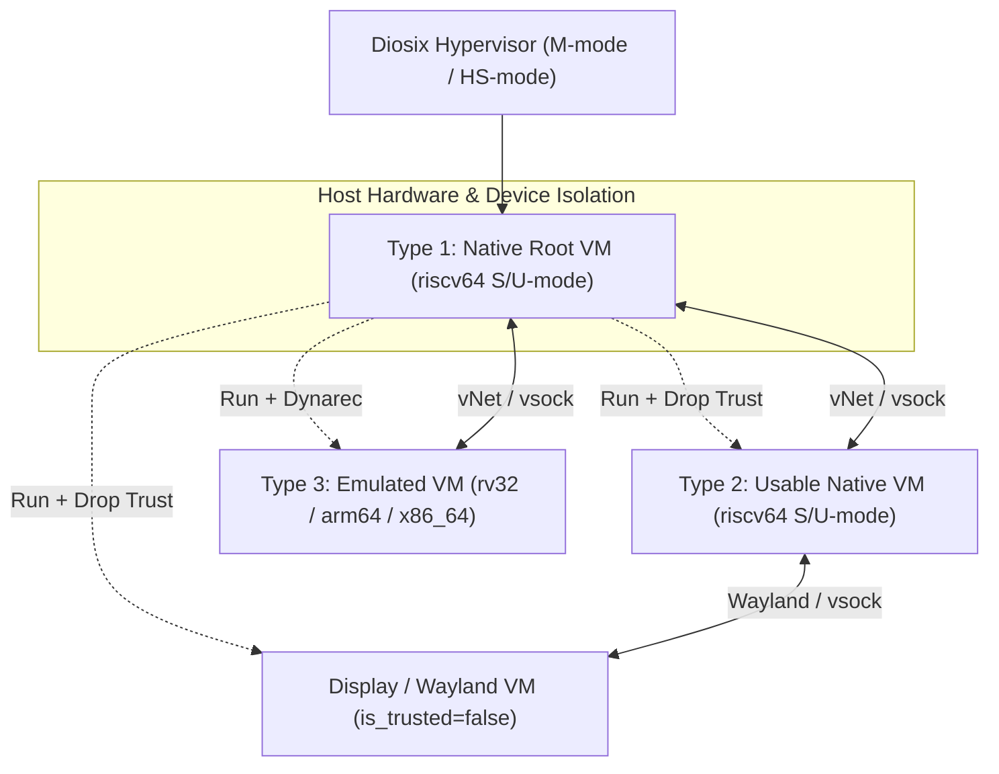
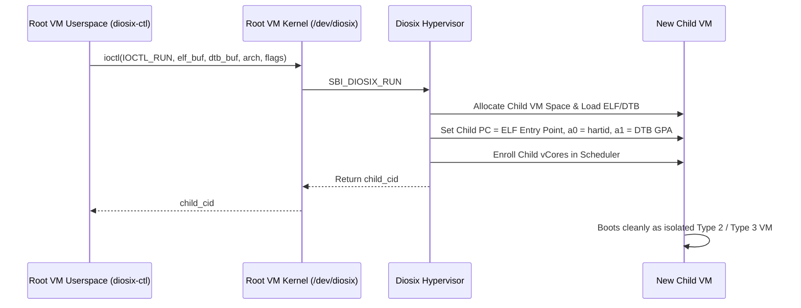

# Diosix guest virtualization & multi-VM architecture: technical plan

This technical plan defines the design, build system orchestration,
communication subsystem, and provisioning lifecycle for multi-Virtual Machine
(VM) guest execution under the **Diosix Hypervisor**.

---

## 1. Architectural overview

Diosix implements a microkernel-inspired hypervisor architecture featuring a
**hierarchical privilege model**:



### Core security & privilege principles
1. **The hypervisor (Machine-mode (M-mode) / Hypervisor Supervisor-mode
   (HS-mode))**: Small, secure, and isolated. Manages Central Processing Unit
   (CPU) scheduling, Stage-2 page tables, and Dynamic Binary Recompiler
   (Dynarec) Just-In-Time (JIT) translation. It does not contain complex host
   device drivers.
2. **Type 1 (native root VM)**: The trusted progenitor VM (`is_root = true`,
   `is_trusted = true`). Holds authority to manage physical hardware (Peripheral
   Component Interconnect Express (PCIe), Universal Serial Bus (USB), storage,
   Ethernet, Graphics Processing Unit (GPU)) and initiate hypervisor-level guest
   lifecycle actions.
3. **Type 2 & Type 3 (unprivileged guests)**: Sandboxed (`is_trusted = false`).
   They communicate with other VMs and storage via standardized Internet
   Protocol (IP) networking (VirtIO-net / Secure Shell (SSH) / network file
   systems).

---

## 2. Specification of the three guest types

```text
                       GUEST PAYLOAD MATRIX
┌──────────────┬──────────────────┬──────────────────┬──────────────────┐
│ Attribute    │ Type 1: Root VM  │ Type 2: Native   │ Type 3: Emulated │
├──────────────┼──────────────────┼──────────────────┼──────────────────┤
│ Target Arch  │ riscv64 (Native) │ riscv64 (Native) │ rv32/arm64/x86   │
│ Execution    │ Stage-2 (H-ext)  │ Stage-2 (H-ext)  │ Dynarec JIT      │
│ Compression  │ Compressed cpio  │ Compressed cpio  │ Uncompressed ELF │
│ Kernel       │ Full Host Stack  │ Minimal Virtual  │ Minimal Virtual  │
│ Userspace    │ BusyBox + dsx    │ Dev / App Suite  │ Targeted App     │
│ Privilege    │ Trusted Root     │ Sandboxed        │ Sandboxed        │
│ Location     │ Embedded in HV   │ Virtual Storage  │ Virtual Storage  │
└──────────────┴──────────────────┴──────────────────┴──────────────────┘
```

### Type 1: Native root VM (`riscv64`)
* **Purpose**: Hardware orchestration, disk management, network routing, and VM
  provisioning.
* **Kernel configuration (`boot/riscv64-linux-rootvm.config`)**:
  * Rich driver set: PCIe root complex (`CONFIG_PCIE_RISCV_HOST`), USB host
    controllers (eXtensible Host Controller Interface (XHCI) / Enhanced Host
    Controller Interface (EHCI)), storage (Non-Volatile Memory Express (NVMe),
    Advanced Host Controller Interface (AHCI), MultiMediaCard (MMC) / Secure
    Digital (SD), VirtIO-blk), networking (Realtek, Intel, VirtIO-net),
    video/display (Direct Rendering Manager (DRM) / Kernel Mode Setting (KMS),
    SimpleFB, VirtIO-GPU), and input (`evdev`, USB Human Interface Device
    (HID)).
* **Userspace**:
  * Lightweight BusyBox + Python + `diosix-ctl` (`dsx`) daemon.
  * Initialization scripts (`/etc/init.d/S50diosix`) that mount storage and
    configure Network Address Translation (NAT) and routing.
* **Privilege**: Trusted Supervisor-mode (S-mode) and User-mode (U-mode). Can
  perform hypercalls to spawn guests, map physical Memory-Mapped Input/Output
  (MMIO) ranges, and manage children.

### Type 2: Usable native VM (`riscv64`)
* **Purpose**: General-purpose productivity, software development, compiling,
  server hosting, and interactive applications.
* **Kernel configuration (`boot/riscv64-linux-usable.config`)**:
  * Ultra-stripped virtual kernel using `boot/linux-minimal.fragment`.
  * Only contains: RISC-V timer (`riscv_clocksource`), SiFive Platform-Level
    Interrupt Controller (PLIC), Supervisor Binary Interface (SBI) Debug Console
    (DBCN) (`hvc0`), and VirtIO network/socket interfaces.
* **Userspace**:
  * Full developer suite: GNU Compiler Collection (GCC) / Clang, Zig, Make, Git,
    package managers, full Python 3 environment, OpenSSH server (`sshd`),
    coreutils, Zsh, and text editors (Vim/Nano).
  * Compressed with Zstandard (`CONFIG_INITRAMFS_COMPRESSION_ZSTD=y`).

### Type 3: Lightweight non-native VM (`riscv32`, `aarch64`, `x86_64`)
* **Purpose**: Running architecture-specific Executable and Linkable Format
  (ELF) binaries and services under dynamic recompilation.
* **Kernel configuration (`boot/riscv32-linux-minimal.config`, etc.)**:
  * Stripped virtual kernel with `CONFIG_EXPERT=y` and `CONFIG_ARCH_VIRT=y`.
  * Memory footprint $\le 16\text{ MB}$.
* **Userspace**:
  * Minimal BusyBox + target application payload + non-native `diosix-ctl`.
  * **Uncompressed** (`CONFIG_INITRAMFS_COMPRESSION_NONE=y` and
    `BR2_TARGET_ROOTFS_CPIO_NONE=y`) to eliminate decompression latency during
    JIT boot.

---

## 3. Build system & toolchain automation

The build system in [`build.zig`](../build.zig) and
[`build.sh`](../scripts/build.sh) is structured to allow granular build-time
selection of guest bundles.

```text
                          BUILD PIPELINE FLOW
┌──────────────────────┐   ┌──────────────────────┐   ┌──────────────────────┐
│  Compile diosix-ctl  │   │   Buildroot Guests   │   │  Hypervisor Linker   │
│  (Zig cross-target:  ├──►│  (Overlay diosix-ctl ├──►│  (Embed Root VM,     │
│  rv64, rv32, arm64)  │   │  into rootfs images) │   │  Package guests.img) │
└──────────────────────┘   └──────────────────────┘   └──────────────────────┘
```

### 3.1 Build configuration options
In [`build.zig`](../build.zig), define build options for guest composition:

```zig
// Root VM is always required and embedded into the hypervisor
const root_vm_config = b.option(
    []const u8,
    "root-vm",
    "Root VM config",
) orelse "riscv64-root";

// Optional secondary guest VM payloads to build and bundle
const build_native_guest = b.option(
    bool,
    "with-native-guest",
    "Build usable native riscv64 guest",
) orelse false;
const build_rv32_guest = b.option(
    bool,
    "with-rv32-guest",
    "Build lightweight non-native riscv32 guest",
) orelse false;
const build_arm64_guest = b.option(
    bool,
    "with-arm64-guest",
    "Build lightweight non-native aarch64 guest",
) orelse false;
```

### 3.2 Programmatic cross-compilation of `diosix-ctl`
Write `diosix-ctl` in Zig ([`main.zig`](../tools/diosix-ctl/src/main.zig)) so
that Zig's built-in multi-target cross-compiler can generate statically linked
binaries for all target architectures with zero external toolchain dependencies:

```zig
// In build.zig:
fn buildDiosixCtl(
    b: *std.Build,
    target_arch: std.Target.Cpu.Arch,
) *std.Build.Step.Compile {
    return b.addExecutable(.{
        .name = "diosix-ctl",
        .root_module = b.createModule(.{
            .root_source_file = b.path("tools/diosix-ctl/src/main.zig"),
            .target = b.resolveTargetQuery(.{
                .cpu_arch = target_arch,
                .os_tag = .linux,
                .abi = .musl,
            }),
            .optimize = .ReleaseSmall,
        }),
        .linkage = .static,
    });
}
```

### 3.3 Buildroot rootfs overlay integration
During Buildroot image generation, Buildroot's `BR2_ROOTFS_OVERLAY` mechanism
automatically copies `diosix-ctl` and system service scripts directly into
`/sbin/diosix-ctl` and `/etc/init.d/`:

```text
tools/overlay-common/
├── sbin/
│   └── diosix-ctl        <- Populated from zig build
├── etc/
│   ├── init.d/
│   │   └── S50diosix     <- Daemon / service launcher
│   └── diosix/
│       └── config.json   <- Guest identity & capabilities
```

### 3.4 Secondary guest storage & packaging
* **Root VM**: Embedded directly into the hypervisor binary at the `.rootvm`
  linker section.
* **Secondary guests**: Packaged into a virtual disk image
  (`zig-out/images/guests.img` or a 9pfs/VirtIO directory `zig-out/guests/`).
  * In Quick Emulator (QEMU): Attached via `-drive
    file=zig-out/images/guests.img,format=raw,id=hd0 -device
    virtio-blk-device,drive=hd0`.
  * On real silicon: Stored on an NVMe, Embedded MultiMediaCard (eMMC), or SD
    card partition that the Root VM mounts on boot (`/var/lib/diosix/guests/`).

---

## 4. Hypervisor management & inter-VM communication

### 4.1 The SBI hypercall interface (`EXT_DIOSIX = 0x0a000005`)
The hypervisor implements a clean extension to standard RISC-V SBI
([`sbi.zig`](../hypervisor/interface/sbi.zig)):

| Function ID | Function Name | Arguments | Description |
| :--- | :--- | :--- | :--- |
| `0` | `DIOSIX_TERMINATE` | `target_cid` | Terminate the calling guest VM (`0`) or a direct child VM and reclaim resources. |
| `1` | `DIOSIX_YIELD` | — | Yield remaining virtual CPU (vCPU) time slice to other runnable vcores. |
| `3` | `DIOSIX_DROP_TRUST` | — | Irrevocably drop Root/Trusted privilege for the calling VM. |
| `4` | `DIOSIX_RUN` | `RunArgs` Guest Physical Address (GPA) pointer | Create a child VM memory space with a new guest binary and start it. |
| `5` | `DIOSIX_GET_INFO` | `out_buf_gpa, buf_len` | Query hypervisor telemetry, guest VM list, and resource quotas. |
| `6` | `DIOSIX_SET_QUOTA` | `target_id, max_ram, max_vcpus, max_prio` | Adjust Random-Access Memory (RAM), vCPU, and priority quota limits for a child VM. |

### 4.2 Guest kernel driver: `/dev/diosix`
Userspace applications in Linux (U-mode) cannot execute SBI `ecall` instructions
directly to M-mode (they trap to S-mode). A minimal kernel character driver
(`diosix.ko` from [`diosix.c`](../tools/driver/diosix.c)) bridges this gap:

```text
[Userspace diosix-ctl]  ---> ioctl(/dev/diosix, IOCTL_RUN)
                                     │
                                     ▼ (Kernel S-mode)
                          sbi_ecall(0x0a000005, DIOSIX_RUN)
                                     │
                                     ▼ (Hypervisor M-mode)
                          handleDiosix() -> Guest.createChild()
```

#### Supported `ioctl` operations:
* `IOCTL_DROP_TRUST`: Drops VM privilege.
* `IOCTL_RUN`: Instantiates a clean child VM and loads a guest image.
* `IOCTL_GET_HV_INFO`: Reads system telemetry and host info.
* `IOCTL_SET_MANIFEST` / `IOCTL_GET_MANIFEST`: Stages/retrieves VM capabilities.

---

## 5. VM provisioning & guest execution lifecycle

To start a new guest, the Root VM uses the **`dsx run`** command:



When the hypervisor handles `SBI_DIOSIX_RUN`, it initializes the child's
Device Tree Blob (DTB) GPA and Program Counter (PC), enrolls the child's vcores,
and returns the child's Context Identifier (CID).

---

## 6. Inter-VM networking, display, and service remoting

### 6.1 Virtual network routing (Layer-2/Layer-3 vSwitch)
* **Hypervisor virtual bridge**: The hypervisor provides a fast, shared-ring
  packet transfer mechanism (similar to VirtIO-net / shared memory ring
  buffers).
* **Root VM as gateway**:
  * The Root VM owns the physical Ethernet / Wi-Fi Network Interface Card (NIC).
  * The Root VM runs `iptables`/`nftables` + `dnsmasq` to provide Dynamic Host
    Configuration Protocol (DHCP) and NAT (`10.0.3.1/24`) to all child VMs.
  * Child VMs get IP addresses (`10.0.3.3`, `10.0.3.4`) and route external
    internet traffic through the Root VM gateway.

### 6.2 Display & windowing architecture
* **Dedicated display server VM**:
  * Root VM spawns a Display VM that holds the physical GPU/DRM device node,
    runs a compositor, and drops root privilege.
* **Wayland over Virtual Socket (VSOCK) / virtual network**:
  * Child VMs run standard Wayland client applications with
    `WAYLAND_DISPLAY=wayland-1`.
  * Wayland protocol messages and shared pixel buffers flow over VirtIO-VSOCK /
    shared memory channels directly to the Display VM compositor.

### 6.3 Terminal & remote access
* Every guest VM runs a lightweight OpenSSH / Dropbear daemon listening on its
  internal vNet interface.
* The user in the Root VM can connect directly:
  ```bash
  dsx list
  # ID  ARCH     TYPE     STATUS   IP          MEM
  # 1   riscv64  Root     Running  10.0.3.1    512M
  # 2   riscv64  Native   Running  10.0.3.2    1024M
  # 3   riscv32  Dynarec  Running  10.0.3.3    128M

  dsx attach 2                # Attach to virtual console
  # OR
  ssh root@10.0.3.2           # Open full interactive terminal shell
  ```

---

## 7. Implementation roadmap & milestones

### Milestone 1: Buildroot & guest kernel profiles
* [ ] Create `boot/riscv64-linux-rootvm.config` with complete host storage,
  network, and PCIe driver support.
* [ ] Create `boot/riscv64-linux-usable.config` with minimal virtual kernel and
  full developer userspace.
* [ ] Update `boot/linux-minimal.fragment` to serve as the shared base for
  Type 2 and Type 3 virtual guests.

### Milestone 2: `diosix-ctl` & kernel character driver
* [ ] Implement `tools/diosix-ctl` in Zig with cross-compilation support for
  `riscv64`, `riscv32`, and `aarch64`.
* [ ] Implement [`diosix.c`](../tools/driver/diosix.c) guest kernel character
  driver exposing `/dev/diosix`.
* [ ] Add Buildroot overlay scripts to automatically package `diosix-ctl` and
  `/dev/diosix` module into all guest rootfs builds.

### Milestone 3: Hypervisor SBI extension & spawn API
* [ ] Extend `handleDiosix` in
  [`diosix.zig`](../hypervisor/core/sbi/diosix.zig) with `RUN`, `GET_INFO`,
  `SET_QUOTA`, and `MANIFEST` Application Programming Interface (API) function
  IDs.
* [ ] Implement the `RUN` ELF loader routine in
  [`guest.zig`](../hypervisor/core/guest.zig) to populate a child VM's address
  space with a new guest image and initialize its entry state.

### Milestone 4: Storage packaging & multi-VM build options
* [ ] Update [`build.zig`](../build.zig) with `-Dwith-native-guest` and
  `-Dwith-nonnative-guest` options.
* [ ] Create packaging rules to produce `guests.img` virtual disk containing
  secondary guest ELF binaries.
* [ ] Validate end-to-end multi-VM spawning from `diosix-ctl` inside the Root
  VM.
