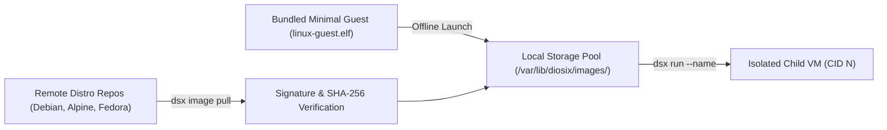

# Diosix live image, installation, and networking plan

This document details the architectural roadmap to transition Diosix from a
virtualized development environment into a production-ready, daily-driver
Type-1 hypervisor for 64-bit RISC-V (`riscv64`) host hardware.

The design adheres strictly to the **Diosix Security Model**: maintaining a
minimal Trusted Computing Base (TCB), enforcing lineage isolation, delegating
hardware access using the principle of least privilege, and keeping
Machine-mode (M-mode) free of network protocol parsing.

---

## 1. Architectural principles

Diosix manages Virtual Machines (VMs) hierarchically. The progenitor guest is
the **Root VM** (trusted host supervisor), which supervises direct descendant
child VMs. The hypervisor core acts as an execution scheduler, memory isolation
barrier (via G-stage extended page tables or Physical Memory Protection (PMP)),
and Layer-2 virtual Ethernet frame router.

```mermaid
flowchart TD
    subgraph "Host Hardware"
        NIC["Physical Network Controller"]
        STORAGE_HW["Host NVMe / eMMC / SD Storage"]
    end

    subgraph "Diosix Bare-Metal Hypervisor (M-mode)"
        MMU["G-Stage MMU & PMP Isolation Engine"]
        VSWITCH["Layer-2 Virtual Switch (NET_SEND / NET_RECV)"]
    end

    subgraph "Guest VM Lineage Tree"
        ROOT["Root VM (CID 1, Trusted Supervisor)"]
        NETVM["Net/Firewall VM (Passthrough NIC & NAT)"]
        CHILD1["User VM: Workstation (CID 3, 10.0.3.3)"]
        CHILD2["User VM: Sandboxed App (CID 4, 10.0.3.4)"]
    end

    NIC -->|Root VM Driver / Passthrough| ROOT
    STORAGE_HW -->|Block Storage /dev/vda| ROOT
    ROOT <-->|vNIC (10.0.3.1)| VSWITCH
    NETVM <-->|vNIC (10.0.3.2)| VSWITCH
    CHILD1 <-->|vNIC (10.0.3.3)| VSWITCH
    CHILD2 <-->|vNIC (10.0.3.4)| VSWITCH
```

In this topology, the G-stage Memory Management Unit (MMU) and PMP enforce
address isolation across Context Identifiers (CIDs), while the Root VM provides
Command-Line Interface (CLI) management (`dsx`) over Non-Volatile Memory
Express (NVMe), Embedded MultiMediaCard (eMMC), and Secure Digital (SD) storage
and routes virtual Network Interface Card (vNIC) traffic through Network
Address Translation (NAT) and Dynamic Host Configuration Protocol (DHCP).

---

## 2. Phase 1: External networking gateway & internet access

### Architectural overview

Child VMs require outbound Internet Protocol (IP) connectivity to download
packages, clone git repositories, and interact with remote services, while
remaining network-isolated from unauthorized lateral access.

### Design: root VM NAT gateway

During Phase 1, the privileged Root VM acts as the IPv4 NAT gateway for all
descendant child VMs attached to the virtual network subnet (`10.0.3.0/24`):

1. **In-hypervisor Layer-2 switch**:
   - The hypervisor routes raw Ethernet frames between guest CIDs using the
     `DIOSIX.NET_SEND` (Function ID 16) and `DIOSIX.NET_RECV` (Function ID 17)
     Supervisor Binary Interface (SBI) hypercalls.
   - The hypervisor does not parse Layer-3 (IP) or Layer-4 (Transmission
     Control Protocol (TCP) / User Datagram Protocol (UDP)) headers,
     eliminating network parsing exploits in M-mode.

2. **Root VM gateway configuration**:
   - The Root VM enables IPv4 packet forwarding via `sysctl`
     (`net.ipv4.ip_forward=1`).
   - Netfilter / `iptables` NAT masquerading rules translate outbound traffic
     from `diosix0` (`10.0.3.0/24`) through the host physical Network Interface
     Card (NIC) (e.g., `eth0`):
     ```sh
     iptables -t nat -A POSTROUTING -s 10.0.3.0/24 ! -d 10.0.3.0/24 \
       -j MASQUERADE
     iptables -A FORWARD -s 10.0.3.0/24 -j ACCEPT
     iptables -A FORWARD -d 10.0.3.0/24 -m state \
       --state RELATED,ESTABLISHED -j ACCEPT
     ```

3. **Child VM default route & Domain Name System (DNS)**:
   - Child VMs automatically configure `10.0.3.1` (the Root VM) as their
     default gateway:
     ```sh
     ip route add default via 10.0.3.1 dev diosix0
     ```
   - DNS resolvers fall back to standard upstream nameservers (such as `1.1.1.1`
     and `8.8.8.8`) or local DNS forwarding proxies.

4. **Security analysis**:
   - Child VMs cannot reach the host's physical network directly; all external
     packets are NAT-isolated.
   - Child VMs cannot spoof other CIDs because the hypervisor overwrites the
     source Media Access Control (MAC) address to match the sender's
     authenticated CID (`02:00:00:00:00:<CID>`).

---

## 3. Phase 2: Universal RISC-V bootable live & installer media

### Target hardware platforms

The live media target standard 64-bit RISC-V Single-Board Computers (SBCs) and
development boards:
* **StarFive VisionFive 2** (JH7110 quad-core RV64GC)
* **Milk-V Mars & Milk-V Pioneer** (JH7110 & SG2042 64-core)
* **SiFive HiFive Unmatched & Premier P550** (Freedom U740 & ESWIN EIC7700)
* **Banana Pi BPI-F3** (SpacemiT K1 octa-core)
* **Quick Emulator (QEMU) `virt` Platform** (Reference development platform)

### Boot pipeline

Diosix interfaces cleanly with the standard RISC-V boot flow from Read-Only
Memory (ROM) and Secondary Program Loader (SPL) through Supervisor-mode
(S-mode) U-Boot or Unified Extensible Firmware Interface (UEFI):

```text
ROM / SPL -> OpenSBI (M-mode) -> U-Boot (S-mode) / EDK2 (UEFI)
          -> Extlinux / EFI Stub -> Diosix Hypervisor -> Root VM
```

### Disk partition scheme (GPT)

The generated image (`diosix-live-riscv64.img`) employs a hybrid Globally
Unique Identifier (GUID) Partition Table (GPT) layout compatible with both raw
U-Boot SPL offsets and UEFI firmwares, including a Flattened Image Tree (FIT)
payload, an EFI System Partition (ESP) formatted as File Allocation Table
(FAT32), and Device Tree Blobs (DTBs):

| Partition | Label | Filesystem | Typical Size | Description |
| :--- | :--- | :--- | :--- | :--- |
| **Slice 0** | `FIRMWARE` | Raw | 16 MB | Board-specific SPL (`u-boot-spl.bin.normal.out`) and U-Boot FIT image (`u-boot.itb`). |
| **Partition 1** | `ESP` / `BOOT` | FAT32 | 128 MB | ESP containing `extlinux/extlinux.conf`, `vmdiosix.elf`, and DTBs (`.dtb`). |
| **Partition 2** | `DIOSIX_SYS` | ext4 / squashfs | 512 MB | Live Root VM system image (read-only base + volatile `tmpfs` overlay). |
| **Partition 3** | `DIOSIX_DATA` | ext4 | $\ge 2$ GB | Persistent VM storage pool for guest images (`/var/lib/diosix/images/`), manifests, and persistent disks. |

### Extlinux configuration (`extlinux/extlinux.conf`)

```text
menu title Diosix Hypervisor Boot Menu
timeout 30
default diosix-live

label diosix-live
    menu label Diosix Bare-Metal Hypervisor (Live System)
    kernel /boot/vmdiosix.elf
    fdt /boot/dtbs/current.dtb
    append console=ttyS0,115200 earlycon
```

---

## 4. Phase 3: Text user interface installer (`dsx host install`)

When booting from the live media, the Root VM provides an interactive Text User
Interface (TUI) and CLI installer (`dsx host install`) alongside Random-Access
Memory (RAM) live evaluation:

```text
+-------------------------------------------------------------+
|               Diosix RISC-V Hypervisor Setup                |
+-------------------------------------------------------------+
|  [1] Live Evaluation (Run entirely in RAM with demo VM)     |
|  [2] Install Diosix to Target Disk (NVMe / eMMC / SD)       |
|  [3] Network & Firewall Setup (Configure NAT / DHCP)        |
|  [4] Shell / Diagnostic Console                             |
+-------------------------------------------------------------+
```

### Installation steps
1. **Target selection**: Detects available host storage block devices
   (`/dev/nvme0n1`, `/dev/mmcblk0`, `/dev/sda`).
2. **Partitioning & formatting**: Creates the standard GPT partition table on
   the target disk.
3. **Payload installation**: Writes the hypervisor binary, bootloader files,
   and Root VM environment to the target partitions.
4. **Volume initialization**: Seeds the persistent storage partition with
   standard directories, `/etc/diosix/system.toml`, and Secure Shell (SSH) host
   keys.

---

## 5. Phase 4: Remote guest OS catalog (`dsx image`)

To support standard Linux Operating System (OS) distributions alongside custom
micro-appliances, the guest management utility (`diosix-ctl` / `dsx`) provides
declarative OS image orchestration with Secure Hash Algorithm 256-bit (SHA-256)
verification:



### CLI commands

* `dsx image catalog` (or `dsx image list --remote`): Queries verified upstream
  distributions for `riscv64` (e.g., Debian 13 "Trixie", Alpine Linux 3.20,
  Ubuntu 24.04 Long-Term Support (LTS)).
* `dsx image pull <distro>`: Downloads cloud-init / raw VM images via Hypertext
  Transfer Protocol Secure (HTTPS) and verifies SHA-256 digests.
* `dsx image inspect <distro>`: Displays catalog metadata, SHA-256 checksums,
  and local cache status.

### Security verification
All downloaded guest images are verified against embedded root-of-trust digests
before being permitted to execute. Guest VMs run strictly untrusted by default
(`hardware trust: no`), confining them to their allotted memory quotas and
virtual networking queues.

---

## 6. Phase 5: Hardware disaggregation (`sys-net` & `sys-firewall`)

For maximum security hardening, Phase 5 transitions from Root VM NAT routing to
dedicated, hardware-isolated network domains:

1. **Peripheral Component Interconnect Express (PCIe) / Memory-Mapped
   Input/Output (MMIO) passthrough**: The hypervisor assigns physical
   Ethernet/Wi-Fi controllers directly to a dedicated `sys-net` VM via stage-2
   MMIO mapping hypercalls (`MAP_CHILD_MEM`).
2. **Untrusted Root VM**: The Root VM drops its own hardware trust privilege
   (`DROP_TRUST`) once the initial domains are spawned, leaving the Root VM as
   a pure control-plane coordinator.
3. **Firewall domain (`sys-firewall`)**: Interposes between `sys-net` and user
   workstations, enforcing packet filtering rules in an isolated S-mode virtual
   machine.

---

## 7. Implementation roadmap

| Phase | Description | Key Deliverables | Status |
| :--- | :--- | :--- | :--- |
| **Phase 1** | **External Networking Gateway** | Enable IPv4 forwarding, Netfilter NAT masquerade, and default gateway routing in the Root VM startup service. | **Completed** |
| **Phase 2** | **Live Media Generator Script** | Provide [`make_live_image.sh`](../scripts/make_live_image.sh) to generate bootable hybrid GPT disk images for RISC-V hardware and QEMU. | **Completed** |
| **Phase 3** | **Host Installer (`dsx host install`)** | Develop a lightweight TUI / CLI installation workflow for deploying Diosix to internal storage drives. | **Completed** |
| **Phase 4** | **OS Image Catalog (`dsx image`)** | Add remote image querying, downloading, and checksum verification commands to `diosix-ctl`. | **Completed** |
| **Phase 5** | **Dedicated `sys-net` Passthrough** | Implement stage-2 physical device passthrough for dedicated network and firewall guest VMs. | Scheduled |
