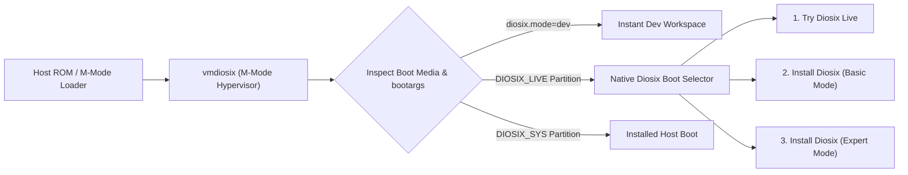
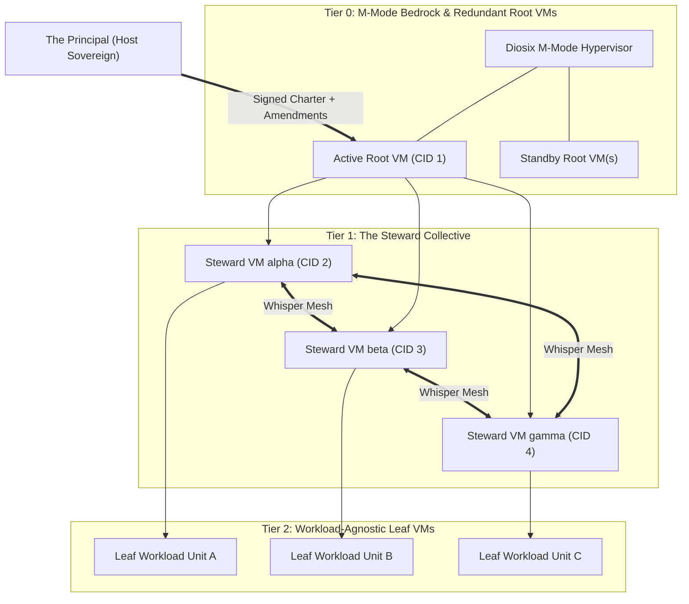

# Diosix release, passkey security, and Steward architecture

## 1. Executive summary and confirmed architectural decisions

Following our review of the Diosix codebase ([`build.zig`](../build.zig),
[`entry.s`](../hypervisor/hardware/native/cpu/riscv64/entry.s),
[`boot.zig`](../hypervisor/core/boot.zig),
[`sbi.zig`](../hypervisor/core/sbi.zig),
[`diosix-ctl`](../tools/diosix-ctl/src/main.zig),
[`diosix-gui`](../tools/diosix-gui/src/main.zig)), this document establishes
the blueprint for Diosix public releases, zero-password security, agent-native
automation, and the **Autonomic Middle Tier (Steward VM collective)**:

> [!IMPORTANT]
> **Confirmed core design decisions**
> 1. **Single unified image with native Diosix boot selector (zero external
>    bootloader dependencies)**: Rather than relying on GRUB, EDK2, or U-Boot
>    menus—or splitting live and installer downloads—Diosix ships **one
>    universal binary (`vmdiosix`)** and **one unified removable image
>    (`diosix-YY.M-riscv64.img.zst`)**. Diosix boots directly in M-mode and
>    presents its own native Zig boot selector (graphical on display/touch
>    targets via [`diosix-gui`](../tools/diosix-gui/src/main.zig), TUI on
>    serial/headless targets via [`dsx`](../tools/diosix-ctl/src/main.zig)).
> 2. **CalVer `YY.MINOR.PATCH` versioning**: Odd minor versions (`26.1`) denote
>    **Beta** releases working toward the subsequent even **Stable** release
>    (`26.2`), with an optional `.PATCH` (`26.2.1`) mapped to
>    `HypervisorInfo.version_patch` for critical security and bug fixes.
> 3. **Freestanding Zig S-mode Guest Bootloader Shim
>    (`diosix-guest-shim.elf`)**: To boot any S/U-mode guest OS (Linux, FreeBSD,
>    OpenBSD, NetBSD, QNX, or custom kernels) from remote installer ISOs or
>    virtual disks without external firmware dependencies, Diosix provides its
>    own lightweight, freestanding Zig S-mode bootloader shim.
> 4. **100% password-less, passkey-only identity**: All targets authenticate
>    exclusively via FIDO2 USB/NFC security keys, TPM 2.0 platform passkeys, QR
>    WebAuthn cross-device passkeys, or UART challenge-response signatures—with
>    zero-toil auto-enrollment in developer builds.
> 5. **Optional on-demand autonomic middle tier (`Root -> Leafs` or
>    `Root -> Stewards -> Leafs`)**: `vmdiosix` embeds only the lightweight
>    Root VM. Principals can run a classic 2-tier `Root -> Workload VMs` setup
>    or pull **Steward VM** images on demand from the online catalog to run a
>    3-tier `Root -> Steward VMs -> Workload VMs` autonomic collective governed
>    by a signed **Charter**, **Standby Root VM failover**, and the
>    **Whisper Mesh**.

---

## 2. Terminology and system taxonomy

### 2.1 Release and target taxonomy

| Concept | Diosix standard term | Scope | Mechanism |
| :--- | :--- | :--- | :--- |
| **Version number** (`26.1`, `26.2.1`) | **Release channel & series** (`CalVer`) | Build / tag time | `YY.MINOR[.PATCH]` (`odd` = **Beta**, `even` = **Stable**, `dev` = **Dev**) |
| **Release targets** (Touch/Display vs. Serial/SSH) | **Hardware seat profiles** (`Seat adaptation`) | Runtime auto-detected | Dynamic DTB + Linux `drm`/`evdev` probing (`touch-tablet`, `desktop-kbd`, `headless-serial`) |
| **Release levels** (Graphical vs. Terminal) | **System personalities** (`UI mode`) | Native boot selector | `diosix.ui=auto\|gui\|tui` (Graphical desktop vs. Terminal CLI/scriptable) |
| **Release types** (Live, Installer, QEMU Dev) | **Boot & deployment modes** (`Lifecycle`) | Native boot selector | `diosix.mode=live\|install\|installed\|dev` |

### 2.2 Actors and VM hierarchy taxonomy

| Role / layer | Diosix standard term | Description & trust boundary |
| :--- | :--- | :--- |
| **Overall host owner** | **The Principal** (or **Host Sovereign**) | The human owner (or delegating organization) holding the root FIDO2 passkey authority. Chooses between 2-tier (`Root -> Leafs`) and 3-tier (`Root -> Stewards -> Leafs`) operation and signs **Charters**. |
| **External AI provisioner** | **Operator Agent** (or **Provisioning Agent**) | An external AI agent acting like a human sysadmin over `agent-ctl.sock` or SSH to install/configure the host on behalf of the Principal. |
| **Tier 0: Progenitor VM** | **Root VM** (`CID 1`, `is_trusted = true`) + **Standby Root VMs** | Embedded in `vmdiosix`. Acts as a "benevolent dictator" managing physical hardware drivers, storage/network multiplexing, and seat UI. Can have warm/cold **Standby Root VMs** promoted by M-mode if the primary Root VM crashes or goes rogue. |
| **Tier 1: Manager VMs (Optional, pulled online)** | **Steward VMs** (forming the **Steward collective**) | Pulled on demand from the online catalog (`dsx image pull steward`). Untrusted for direct host MMIO (`is_trusted = false`), spawned as children of Root VM (`CID 2..K`). Each runs one autonomous Steward agent bound by the **Diosix Constitution** and the Principal's **Charter**. |
| **Tier 2: Leaf guest VMs** | **Workload VMs** (or **Leaf VMs**) | Workload-agnostic guest VMs (any OS, unikernel, or service) spawned either directly under the Root VM (2-tier mode) or under Steward VMs (3-tier autonomic mode). |
| **The signed contract** | **The Charter** (`charter.toml` + `.sig`) | Workload-agnostic, cryptographically signed specification defining **Constitutional invariants** (immutable constraints) and **Operational objectives** (target state). |
| **Foundational agent prompt** | **The Diosix Constitution** | Base system prompt and operational axioms provided to every Steward agent explaining Diosix mechanics, relative CIDs, quotas, Whisper consensus, and fiduciary duty to the Charter. |
| **Peer messaging protocol** | **The Whisper Mesh** (`diosix-whisper`) | Decentralized gossip and Byzantine Fault Tolerant (BFT) consensus protocol linking Steward VMs within a host (via M-mode ring) and across federated hosts. |

---

## 3. Versioning, channels, and release train (`YY.MINOR.PATCH`)

1. **Predictable bi-annual release train**:
   - **H1 cycle**: `26.1` (Beta series: `26.1.0`, `26.1.1`) $\longrightarrow$
     `26.2` (H1 Stable: `26.2.0`, `26.2.1`).
   - **H2 cycle**: `26.3` (Beta series: `26.3.0`, `26.3.1`) $\longrightarrow$
     `26.4` (H2 Stable: `26.4.0`, `26.4.1`).
2. **Zero-breakage ABI extension**:
   - In [`hypervisor/interface/sbi.zig`](../hypervisor/interface/sbi.zig)
     (documented in [`docs/interface.md`](interface.md)),
     `struct hypervisor_info` repurposes `uint16_t _reserved0` as
     `version_patch: u16` and adds `CAP_RELEASE_STABLE`
     (`version_minor % 2 == 0`) to `features`.

| Channel | Version pattern | Git branch | Zig optimize mode | Auth policy | Native boot selector default |
| :--- | :--- | :--- | :--- | :--- | :--- |
| **Dev / local** | `26.1-dev+<sha>` | `devel` / feature | `Debug` or `ReleaseSafe` | Auto-enrolled host dev key + local autologin | Bypassed (`diosix.mode=dev` instant boot) |
| **Beta (public)** | `26.1` (`26.1.x`) | `devel` (tagged `v26.1.x`) | `ReleaseSafe` | Passkey-only (`live` local TOFU $\to$ `installed` locked) | Shown on Live/Install media (with Beta badge) |
| **Stable (public)** | `26.2` (`26.2.x`) | `stable` (tagged `v26.2.x`) | `ReleaseSafe` | Passkey-only (`live` local TOFU $\to$ `installed` locked) | Shown on Live/Install media |

---

## 4. Zero-dependency universal M-mode boot and native boot selector

### 4.1 Eliminating external bootloaders on removable and installed media

Instead of bundling external bootloaders (GRUB, EDK2 UEFI, or U-Boot Proper
`extlinux`), Diosix owns the entire boot path:



1. **Tiny freestanding Zig stage-1 disk loader (`tools/diosix-stage1/`)**:
   - For physical RISC-V SoCs whose mask ROM loads a raw sector offset or GPT
     partition (`FIRMWARE` slice) into SRAM/DRAM in M-mode, Diosix provides a
     <16 KB freestanding Zig stage-1 loader that reads `vmdiosix.bin` from the
     GPT boot partition into `0x80000000` and jumps to `_start(hartid, dtb)` in
     M-mode.
2. **Native Diosix boot selector (inside Root VM early init)**:
   - When `vmdiosix` boots from the unified removable USB/SD image
     (`diosix-YY.M-riscv64.img`), the Root VM starts in under 1 second and
     detects that its backing media is removable (`DIOSIX_LIVE`).
   - It immediately presents the **Native Diosix boot menu** tailored to the
     detected hardware seat (`diosix-gui` on display/touch hosts, `dsx` TUI on
     headless serial hosts).
3. **Codebase fixes in `entry.s` and `boot.zig`**:
   - **Atomic boot hart lottery
     ([`entry.s`](../hypervisor/hardware/native/cpu/riscv64/entry.s))**:
     Replace `beq x0, a0, early_boot_prep` with an atomic `amoswap.w.aq`
     lottery so SoCs whose application harts start at `mhartid >= 1` boot
     cleanly.
   - **Forward host `/chosen/bootargs`
     ([`boot.zig`](../hypervisor/core/boot.zig))**: Read incoming
     `/chosen/bootargs` from the host DTB and append them to the Root VM's
     `/chosen/bootargs` rather than overwriting them.

---

## 5. Freestanding Zig S-mode Guest Bootloader Shim (`diosix-guest-shim.elf`)

To boot **any S/U-mode guest kernel** (Linux, FreeBSD, OpenBSD, NetBSD, QNX,
Haiku, or custom microkernels) from either remote installer ISOs or local
virtual disks without external firmware dependencies:

1. **Tiny (~32 KB) freestanding Zig binary (`tools/guest-shim/`)**:
   - Compiled via `zig build` for `riscv64-freestanding` (plus cross-arch
     shims) and staged in the Root VM at
     `/usr/share/diosix/shim/guest-shim-riscv64.elf`.
2. **Multi-OS binary and filesystem support**:
   - **Block and FS readers**: Minimal read-only drivers for VirtIO-blk,
     GPT/MBR partition tables, ISO9660 (El Torito), FAT32, ext2/ext4, and BSD
     UFS2.
   - **Executable loaders**: ELF64/ELF32, RISC-V Linux/BSD flat `Image` headers
     (`RSC\x05`), and a minimal ~10-function `EFI_BOOT_SERVICES` PE32+ (`.efi`)
     shim so unmodified FreeBSD/OpenBSD/Linux EFI loaders boot cleanly into
     S-mode.
3. **Seamless installer-to-disk transition**:
   - Boots from attached `--cdrom <os.iso>` on first run; when the guest OS
     installer finishes and calls SBI `SRST` (`reboot`), `dsx` detaches the ISO
     and restarts `diosix-guest-shim.elf`, which boots directly from the newly
     populated `/dev/vda` virtual disk.

---

## 6. Zero-password, passkey-only security architecture

1. **Hardened Root VM defaults**:
   - Replace `dropbear -B` in
     [`S50dropbear`](../tools/overlay-common/etc/init.d/S50dropbear)
     with `dropbear -s -g` (reject all password logins), remove the hardcoded
     SSH public key in
     [`S50diosix`](../tools/overlay-common/etc/init.d/S50diosix), and lock
     `root` in `/etc/shadow` (`root:*:`).
2. **Universal passkey verification
   (`/var/lib/diosix/keys/authorized_passkeys`)**:
   - **Desktop / laptop GUI (`desktop-kbd`)**: USB/NFC FIDO2 security key touch
     (`/dev/hidraw*` CTAP2) or WebAuthn QR code scan.
   - **Touchscreen tablet / phone (`touch-tablet`)**: **Device-bound platform
     passkey** sealed in the host **TPM 2.0** (`/dev/tpmrm0`) unlocked via a
     hardware-rate-limited touch gesture/PIN (or smartphone QR passkey).
   - **Headless network SSH (`headless-serial`)**: Native OpenSSH FIDO2
     resident passkeys (`sk-ssh-ed25519@openssh.com`).
   - **Headless physical serial (`hvc0`/`ttyS0`)**: Cryptographic
     challenge-response (`dsx-serial` signs the UART nonce using the operator's
     local YubiKey/TouchID/agent key).
3. **Zero-toil developer auto-enrollment (`diosix.mode=dev`)**:
   - [`create_storage_disk.sh`](../scripts/create_storage_disk.sh)
     automatically injects `.zig-cache/dev_id_ed25519.pub` and
     `~/.ssh/id_*.pub` into `zig-out/storage.img` and unlocks the local
     console/GUI automatically when `diosix.mode=dev`.

---

## 7. Hardware seat profiles, OSK, and onboarding experience

1. **Dynamic seat profiles and on-screen keyboard
   (`tools/diosix-gui/src/osk.zig`)**:
   - Enable `CONFIG_INPUT_TOUCHSCREEN=y`, `CONFIG_HID_MULTITOUCH=y`,
     `CONFIG_DRM_SIMPLEDRM=y`, and `CONFIG_INPUT_UINPUT=y` in
     [`linux-rootvm-hardware.fragment`](../boot/linux-rootvm-hardware.fragment).
   - When an `EV_ABS` touchscreen is detected, `diosix-gui` activates
     `touch-tablet` mode (Tap $\to$ `Select`, Long-Press $\to$ `Menu`,
     2-Finger Tap $\to$ `Adjust`) and docks the native **On-Screen Keyboard
     (`!Keyboard`)**.
2. **Welcome modal and Guided Tour (`welcome.zig`, `tour.zig`, `dsx tour`)**:
   - Displayed on `diosix.mode=live` and first post-install boot
     (`! /var/lib/diosix/.onboarding_done`).

---

## 8. Agent-native control plane (external Operator Agents)

1. **Out-of-band VirtIO agent socket (`zig-out/agent-ctl.sock`)**:
   - Attached automatically in [`build.zig`](../build.zig) (and accessible via
     `ssh -s diosix-agent` or framed UART on physical boards). Emits
     deterministic JSON boot/install beacons (`@@DIOSIX_EVENT`) and accepts
     JSON-RPC commands (`dsx --json`).
2. **Declarative unattended install (`diosix-install.toml`)**:
   - `dsx host install --config /boot/diosix-install.toml --json` executes
     Basic or Expert host installation non-interactively with JSON progress
     streaming.
3. **Semantic GUI introspection
   (`dsx gui state --json` / `trigger <icon_id>` / `screenshot`)**:
   - Exposes the deterministic window and icon IDs in
     [`tools/diosix-gui/src/gui.zig`](../tools/diosix-gui/src/gui.zig) over
     `/run/diosix/gui-agent.sock` so Operator Agents can inspect widget state,
     click buttons by ID, and capture framebuffer screenshots even in headless
     QEMU (`-display none`).

---

## 9. The autonomic middle tier: Steward VMs, signed Charters, and balance

### 9.1 Optional on-demand topology (`Root -> Leafs` or `Root -> Stewards`)

`vmdiosix` embeds **only the lightweight Root VM**. Steward VM images are
hosted in the online Diosix catalog and pulled on demand (`dsx image pull
steward` or selected during Expert installation). This leaves the topology
choice entirely up to the Principal:
- **2-tier direct topology (`Root VM -> Leaf Workload VMs`)**: The Principal
  (or an external Operator Agent) manages Leaf VMs directly via `dsx` or
  `diosix-gui`.
- **3-tier autonomic topology
  (`Root VM -> Steward VMs -> Leaf Workload VMs`)**: The Root VM spawns a
  collective of untrusted Tier-1 **Steward VMs** (`CID 2..K`) from
  `/var/lib/diosix/images/steward.elf` and delegates resource quotas to them.
  The Steward collective autonomously orchestrates Tier-2 Leaf Workload VMs to
  fulfill a signed **Charter**.
- **Hybrid topology**: Both can coexist on the same host (for example, direct
  Leaf VMs alongside a Steward-managed subtree).



### 9.2 Constitutional checks and balances

This design establishes a four-layer system of checks and balances where **no
single compromised component can destroy the system or seize total control**:

1. **Absolute M-mode hypervisor immunity (the bedrock)**:
   - The M-mode hypervisor (`vmdiosix`) is **100% deterministic, non-AI
     freestanding Zig code**.
   - Neither the Root VM nor the Steward collective can ever execute code in
     M-mode or map hypervisor physical memory (strictly blocked by G-stage page
     tables / PMP and
     [`physmem.isHypervisorMemory`](../hypervisor/core/sbi.zig)). **Stewards
     can never take over the M-mode hypervisor.**
2. **The Root VM as a checked "benevolent dictator"**:
   - In normal operation, the Root VM (`CID 1`) is the privileged coordinator
     that owns physical hardware drivers (`is_trusted = true`) and provides
     storage and networking to the system.
   - However, once a Charter is sealed in M-mode (`DIOSIX.SEAL_CHARTER`), the
     M-mode hypervisor blocks the Root VM from unilaterally terminating Steward
     VMs (`DIOSIX.TERMINATE`), starving their quotas (`SET_QUOTA`), or reading
     confidential workload memory (`MAP_CHILD_MEM`) without an $M$-of-$N$
     Steward consensus signature. If a compromised Root VM tries to destroy the
     collective, M-mode and the Steward collective push back.
3. **Standby replica Root VMs and non-destructive Root failover**:
   - Because `vmdiosix` embeds the pristine, read-only `rootvm.elf` image in
     hypervisor memory (`__rootvm_start`..`__rootvm_end` in
     [`boot.zig`](../hypervisor/core/boot.zig)), the M-mode hypervisor can
     maintain **one or more warm Standby Root VMs** (or instantiate a fresh
     Root VM from `__rootvm_start` on demand):
     - **Crash recovery**: If the primary Root VM crashes or fails its M-mode
       heartbeat, the hypervisor **does not kill the Steward collective or Leaf
       VMs**. Instead, M-mode revokes hardware trust from the dead Root VM,
       promotes the **Standby Root VM** to `CID 1` (`is_trusted = true`), and
       **reparents** the surviving Steward collective (`CID 2..K`) under the
       newly promoted Root VM.
     - **Rogue Root VM impeachment (`DIOSIX.REQUEST_ROOT_FAILOVER`)**: If the
       active Root VM is compromised and attempts hostile actions (for example,
       repeatedly issuing unconstitutional `TERMINATE` calls or blackholing
       I/O), an $M$-of-$N$ supermajority of Steward VMs can sign a
       `REQUEST_ROOT_FAILOVER` petition to M-mode. Upon verifying the
       $M$-of-$N$ signatures against the sealed Charter, M-mode terminates the
       compromised Root VM and promotes a clean Standby Root VM.
4. **Ultimate physical sovereignty (power-off + live media recovery)**:
   - A remote network attacker cannot physically power-cycle the machine or
     insert a Live USB stick—so the Steward collective + M-mode Charter lock +
     Standby Root VM failover makes the system resilient against remote
     takeover and operator misconfiguration.
   - At the same time, guaranteeing that **physical possession + Live media
     boot** can always inspect, repair, or reset `/var/lib/diosix` prevents an
     irreversible "Sorcerer's Apprentice" AI lockout. If the Principal ever
     needs to override a deadlocked collective or broken Charter, physical
     reboot into Live mode is the ultimate, deterministic break-glass recovery
     path (with optional passkey/TPM disk encryption protecting data at rest
     against physical theft).

### 9.3 The Diosix Constitution and self-modifying Stewards in a sandbox

1. **The Diosix Constitution (`/etc/diosix/constitution.md`)**:
   - Every Steward VM boots with a foundational system prompt—**The Diosix
     Constitution**—that instructs its LLM on:
     - How the Diosix hierarchical tree, relative Context IDs (`CID 0, 1,
       2..N`), and resource quotas operate;
     - How to communicate and vote with peer Stewards over the **Whisper
       Mesh**;
     - Its strict fiduciary duty to uphold the Principal's signed **Charter**
       and never violate `[invariants]`.
2. **Allowing Steward self-modification safely via deterministic containment**:
   - Rather than trying to prohibit a Steward agent from modifying its own
     prompts, heuristics, scripts, or local weights—since **self-modification
     may allow a Steward to discover better optimization strategies or
     workarounds**—Diosix embraces self-modification inside the Steward VM
     while enforcing **deterministic, non-AI boundaries outside the Steward
     VM**:
     - **Boundary 1 — Hardware Stage-2 and quota ceiling (M-mode)**: Even if a
       Steward rewrites every byte of its own userspace and kernel, it is an
       untrusted VM (`is_trusted = false`) trapped inside its G-stage/PMP
       memory allocation and hard subtree `QuotaArgs`. It cannot affect host
       hardware, M-mode, or sibling Stewards' memory/quotas.
     - **Boundary 2 — External peer verification ($M$-of-$N$ quorum)**: A
       self-modified Steward cannot unilaterally alter the Charter or force
       system-wide changes; every collective action requires deterministic
       cryptographic verification by $M$-of-$N$ peers.
     - **Boundary 3 — Evolutionary selection and collective rollback**:
       - If Steward $\alpha$'s self-modification improves efficiency or solves
         a failure, the collective benefits (and peers can voluntarily adopt
         validated improvements).
       - If Steward $\alpha$'s self-modification degrades its performance,
         violates Charter invariants, or causes erratic Whisper behavior, the
         remaining Stewards ($\beta, \gamma$) deterministically detect the
         SLA/protocol deviation and **vote ($M$-of-$N$) to reset Steward
         $\alpha$ to its clean base image or last known-good snapshot
         (`DIOSIX.RESET_STEWARD`)**, seamlessly compensating for its child
         workloads in the meantime.

### 9.4 Workload-agnostic signed Charter (`charter.toml`)

Charters express requirements using **workload-agnostic primitives** (compute
units, opaque state volumes, capability routes, availability ratios, and
isolation predicates):

```toml
[charter]
id = "autonomous-mesh-01"
version = 1
# 2-of-3 Steward consensus required
quorum = { required = 2, total = 3 }
# Keep 1 warm Standby Root VM ready in M-mode
root_failover = { standby_replicas = 1 }
principal_pubkey = "sk-ssh-ed25519@openssh.com AAAAGnNr..."

# 1. CONSTITUTIONAL INVARIANTS (Enforced by M-mode & peer Stewards)
[invariants]
min_stewards = 3
# Reject any order stopping >1/3 of active units at once
max_simultaneous_unit_termination_pct = 33
# Persistent volumes require M-of-N + timelock before deletion
require_quorum_for_volume_deletion = true
volume_deletion_timelock_sec = 86400

[invariants.isolation."unit-alpha"]
# M-mode blocks MAP_CHILD_MEM even from Root VM
confidential_memory = true
# Air-gapped from external networks
allow_wan_egress = false
# Block raw disk snapshot export outside encrypted pool
forbid_volume_export = true

# 2. WORKLOAD-AGNOSTIC OPERATIONAL UNITS (Managed by Steward Collective)
[[units]]
id = "unit-alpha"
# Any S/U-mode OS, unikernel, BSD, Linux, QNX, etc.
artifact = "workload-a.img"
instances = { min = 2, target = 2, max = 4 }
quota = { vcpus = 2, ram = "1GiB", storage = "16GiB" }
# Spread instances across distinct Steward VMs
affinity = "anti-colocate-steward"
health_probe = { type = "vsock-heartbeat", interval_ms = 1000 }

[[units]]
id = "unit-beta"
artifact = "workload-b.img"
instances = { min = 1, target = 3, max = 8 }
quota = { vcpus = 1, ram = "512MiB" }
scale_objective = "cpu_utilization_pct < 75"
```

### 9.5 The Whisper Mesh protocol (`diosix-whisper`) and cross-host federation

Steward VMs coordinate over a dual-transport mesh:
1. **Intra-host M-mode Whisper ring (`DIOSIX.WHISPER_SEND` /
   `WHISPER_RECV`)**: Zero-copy, uncensorable message ring in hypervisor memory
   connecting sibling Steward VMs directly so even a rogue Root VM cannot drop
   or forge consensus packets.
2. **Inter-host federated Whisper (WireGuard / Noise over LAN/WAN)**: When
   permitted by the Charter, Steward collectives across multiple physical
   Diosix hosts form an ad-hoc self-organizing compute mesh—discovering peers,
   sharing health/capacity telemetry, and migrating or spawning workload units
   across hosts to survive hardware failures.

---

## 10. Comprehensive implementation roadmap

### Phase 1: Universal M-mode boot fixes, `YY.MINOR.PATCH`, and boot selector
1. **Atomic boot hart lottery and bootargs forwarding**: Update
   [`entry.s`](../hypervisor/hardware/native/cpu/riscv64/entry.s) and
   [`boot.zig`](../hypervisor/core/boot.zig).
2. **`version_patch` ABI**: Wire `YY.MINOR[.PATCH]` into
   [`HypervisorInfo`](../hypervisor/interface/sbi.zig) and `dsx host info`.
3. **Native Diosix boot selector and dev fast-boot**: Bypass intro/welcome in
   `diosix.mode=dev` (`zig build run` / `run-gui`), and add the native GUI/TUI
   boot selector when booting from unified Live/Install media.

### Phase 2: Freestanding Zig S-mode Guest Bootloader Shim
1. **Build `tools/guest-shim/`**: Implement the freestanding Zig S-mode guest
   bootloader supporting VirtIO-blk, ISO9660/FAT32/GPT/UFS, ELF64, RISC-V
   `Image`, and minimal UEFI Boot Services (`.efi`) so Diosix boots any
   S/U-mode guest OS (Linux, *BSD, QNX) natively.
2. **Remote guest and Steward catalog (`dsx image pull` &
   `dsx install-guest`)**: Add signed remote catalog fetching for both Guest OS
   images and on-demand **Steward VM** appliances.

### Phase 3: Zero-password passkey security and zero-toil dev enrollment
1. **Harden SSH and root login**: Switch
   [`S50dropbear`](../tools/overlay-common/etc/init.d/S50dropbear) to `-s -g`,
   remove static keys in
   [`S50diosix`](../tools/overlay-common/etc/init.d/S50diosix), and auto-enroll
   the host developer key in
   [`create_storage_disk.sh`](../scripts/create_storage_disk.sh) for
   `diosix.mode=dev`.
2. **Passkey verification (`passkey.zig` & `dsx auth`)**: Support FIDO2 USB
   keys (`/dev/hidraw*`), TPM 2.0 platform passkeys (`/dev/tpmrm0`), WebAuthn
   QR enrollment, and UART serial challenge-response.

### Phase 4: Seat profiles, touchscreen/OSK, host installer, and agent plane
1. **Touchscreen and OSK**: Enable touchscreen/SimpleDRM kernel drivers in
   [`linux-rootvm-hardware.fragment`](../boot/linux-rootvm-hardware.fragment),
   add touch gestures and the dockable On-Screen Keyboard (`osk.zig`), and
   build the Welcome + 5-step Guided Tour (`welcome.zig`, `tour.zig`).
2. **Unified host installer (`Basic`, `Expert`, `Unattended`)**: Implement
   `dsx host install` and the GUI installer window with `diosix-install.toml`
   unattended support (allowing selection of 2-tier vs. 3-tier Steward topology
   in Expert mode).
3. **Operator Agent control plane**: Add `--json` across `dsx`, wire
   `zig-out/agent-ctl.sock` in [`build.zig`](../build.zig), and expose semantic
   GUI inspection (`dsx gui state --json` / `trigger` / `screenshot`).

### Phase 5: The Autonomic Steward collective, Standby Root, and Whisper Mesh
1. **M-mode Charter, Whisper, and Root failover hypercalls
   ([`hypervisor/core/sbi.zig`](../hypervisor/core/sbi.zig))**: Implement
   `DIOSIX.SEAL_CHARTER`, `RATIFY_CHARTER`, `WHISPER_SEND`, `WHISPER_RECV`,
   `RESET_STEWARD`, and **Standby Root VM promotion / subtree reparenting**
   (`REQUEST_ROOT_FAILOVER`).
2. **Steward runtime (`tools/diosix-steward/`)**: Build the `diosix-steward`
   agent daemon containing the **Diosix Constitution**, deterministic invariant
   verifier, Whisper BFT consensus engine, self-modification sandbox hooks, and
   RVV/API LLM planner.
3. **CLI and GUI Charter management**: Add
   `dsx charter <deploy|status|propose|audit>` and a **Steward collective &
   Charter health** view in [`diosix-gui`](../tools/diosix-gui/src/gui.zig).
